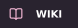
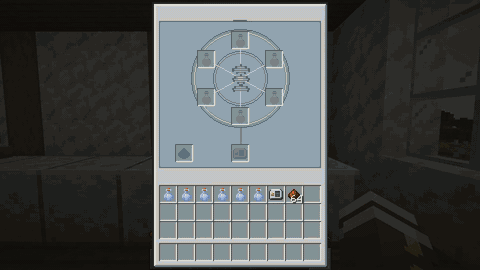

  

  
  
   
  
  

  
  

<h2> Playing as a cat</h2>

Nekogenix lets you play as a neko or a cat and keep using your items, armour and elytra. The transformation happens gradually. You can stop it if you’d rather keep the neko form.

  

<h3> Abilities</h3>

Double-jump, see in the dark, take less fall damage and find creatures by scent. Creepers keep their distance, and you can stay awake without spawning phantoms.

  

<h3> Laboratory</h3>

Prepare your injection with syringes, saliva samples, a centrifuge and a pneumatic stand. The [laboratory guide](https://nekogenix.github.io/wiki/laboratory/) has the recipes and steps.

  

<h3> Cat skins</h3>

Pick a vanilla cat coat or import your own skin. Your choice also changes the ears in neko form.

  

